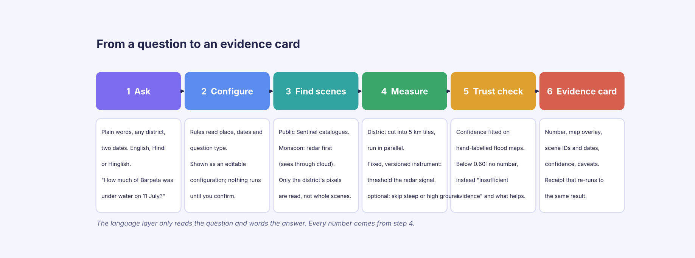
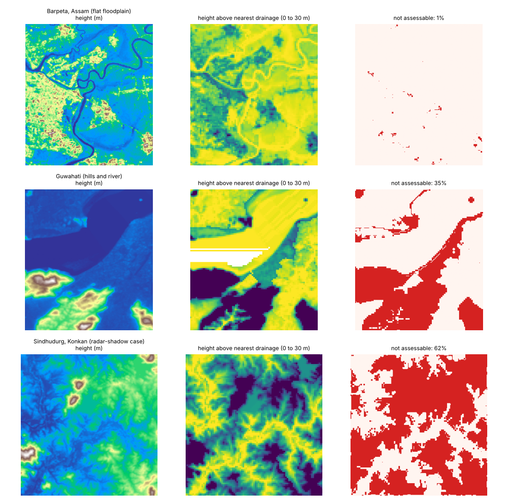

# Tellio: plain-language questions about Indian land, answered with evidence

Team Stardust, Smart India Hackathon 2026, problem statement SIH26167. Report date 2026-10-29. Companion documents: [TECHNICAL_GUIDE.md](TECHNICAL_GUIDE.md) (every technical aspect for a non-specialist), [VERIFICATION.md](VERIFICATION.md) (re-runnable checks), [verification/nrsc_method_review.md](verification/nrsc_method_review.md) (the NRSC method review this report draws on).

> **Naming.** The product is called **Tellio** (formerly EvidEO, and before that SatClip). Code identifiers keep the old name (Python package `evideo`, `EVIDEO_*` environment variables, `config/evideo.yaml`, the repository name). **Screenshots:** Figures 1 and 2 show the new three-step Tellio interface; the two result screenshots (Figures 3 and 4) were captured before the redesign and still show the old header, because live results need the satellite catalogues, which the build sandbox cannot reach. The numbers in them are current.

---

## 1. Abstract

- **What it does.** Tellio takes a question in plain English, Hindi or Hinglish about any of 735 Indian districts and two dates, finds the right Sentinel-1 radar or Sentinel-2 optical passes from public catalogues, measures the change with a fixed, versioned instrument, and returns an **evidence card**: the number, a map of the pixels counted, the scene IDs and dates, a confidence fitted on hand-labelled flood maps, and a receipt that re-runs to the identical result.
- **How it earns trust.** When the evidence is weak it publishes no number: it says "insufficient evidence" and what would help. 8 of 8 receipts re-ran bit-for-bit two days later; water confidence error fell from 0.139 to 0.074 on held-out chips. A whole district (117 tiles) takes 54 to 98 seconds cold on a 2-core CPU and 0.5 seconds when repeated, with no GPU and no hosted language model.
- **What is new in this report.** A review of NRSC's published flood-mapping method (including its 2025 automated method) showed one step our instrument lacked: a terrain mask. We built it (slope and HAND, height above nearest drainage), checked it on real elevation data (flat Barpeta: 0.6% of a tile excluded; Konkan hills at Sindhudurg: 61.5%), and shipped it switched off until the confidence calibration is refitted. It has not yet been run on a real radar scene.

---

## 2. Introduction

Every monsoon, India's 700-plus districts ask the same two questions: *where is it flooded, and is it spreading?* and, later, *did the crop fail?* The satellites that can answer (Copernicus Sentinel-1 radar and Sentinel-2 optical) are free and public, but the answer today requires a trained analyst, a threshold picked by hand per scene, and often a day or two. India's own task force counted roughly 25,000 to 50,000 trained geospatial users against a need for about 500,000 more, and the monsoon is exactly when optical satellites are blind: cloud cover exceeds 60% over most of India from June to September.

Tellio puts that analyst's method behind a question box.


*Figure 1. Step 1, ask. Only language: no pickers. The map is always on the right.*


*Figure 2. Step 2, configuration. Tellio shows how it parsed the question (analysis, district, dates, all editable, re-checked live) and exactly what it will run: `sar_water_otsu v1.2`, radar first in the monsoon, 117 tiles of about 5.6 km, publish only at confidence 0.60. It cannot proceed while something is missing or ambiguous. Step 3 then shows progress and the evidence card.*


*Figure 3. A published answer. "914 sq km, 39% of the 2,335 sq km measured", the confidence bar with the 0.60 publication line, the Sentinel-1 scene (2024-07-11), all 117 map tiles measured, and the measured water on the map. The figure counts all open water including the Brahmaputra and wetlands (see section 7).*


*Figure 4. An honest "no". "Did the flood spread in Barpeta between 5 June and 11 July?" scores 0.23, below the 0.60 line, so no number is shown. The card says what would help and offers two buttons: the water extent on each date, each measured and calibrated on its own. Both were then published (413 and 914 sq km).*

### How it differs from the official channel in turnaround
NRSC's national system is built around analyst-made map sheets issued through NDEM. In 2024 it published about 300 flood products for the whole country; the two 2024 NDEM sheets we checked were issued two days and zero days after the satellite pass, are marked "preliminary" and "no ground verification", and come as PDF sheets. In 2022 and 2023 its RISAT-1A programme produced 67 and 91 maps. Tellio answers the question an official asks about their own district and dates on demand, **in 54 to 98 seconds from question to card** rather than waiting for a sheet to cover their area. The time spent waiting for a satellite to pass overhead is the same for any method; what Tellio removes is the analyst queue. The two are complementary: Tellio also states a per-answer confidence and ships a receipt, which the NRSC sheets do not.

---

## 3. Objectives and problem statement

### Problem statement (SIH26167)
*An interactive vision-language assistant for multimodal remote sensing image analysis through text queries.* Our reading, sharpened by the evidence brief:

| # | Gap | Evidence |
|---|---|---|
| 1 | Questions are local and constant; answers are produced centrally | About 300 national flood products in 2024 for 700-plus districts |
| 2 | Skilled analysts are scarce | About 25,000 to 50,000 trained users versus about 500,000 needed (2013 task force; no newer official count) |
| 3 | Optical imagery fails when it is needed | Cloud over 60% in the monsoon; three Western Ghats districts averaged 90 to 92% cloud in July and August |
| 4 | Fluent AI is not trustworthy for measurement | General vision-language models score about 0.16 mIoU on localisation versus 0.68 for a specialist; free-form agents get tool arguments right about 26% to 35% of the time |
| 5 | Maps carry no per-answer confidence or audit trail | Official sheets carry a preliminary-use disclaimer only |

### Objectives
1. **Answer, don't chat.** Every number comes from a named, versioned, transparent instrument; the language layer only parses the question and words the answer.
2. **Be honest about uncertainty.** A fitted, published confidence on each answer, a stated publication line (0.60), and abstention with a next step instead of a guess.
3. **Be checkable.** Scene IDs, dates and a receipt that re-runs to the same hash.
4. **Work when it is cloudy.** Radar first in the monsoon, with automatic fallback between sensors.
5. **Be easy and cheap to run.** CPU only, free public data, no training required for day-one value; usable by officials without GIS skills, in English, Hindi and Hinglish, on a phone.
6. **Close method gaps found in the literature.** Latest: terrain exclusion, from the NRSC review.

### Users
District disaster officials; agriculture and crop-insurance officers; journalists and fact-checkers; town planners. Beachhead: monsoon flood and crop-condition questions at district level.

---

## 4. Workflow



*Figure 5. One slide: ask, understand, find scenes, measure, trust check, evidence card. Step 4's terrain skip is the optional new mask.*

**Text blobs for the slide**

| Step | What happens | The one fact to say aloud |
|---|---|---|
| 1 Ask | One question box, free text, any of 735 districts, any dates | English, Hindi and Hinglish; works on a phone |
| 2 Configure | Rules read place, dates, question type; the result is shown as an editable configuration plus the technical settings | Nothing runs until the user confirms; a missing or ambiguous detail blocks the Run button; unsupported questions are refused in 0.01 s |
| 3 Find scenes | Public STAC catalogues, three with failover | Monsoon: radar first, because it sees through cloud |
| 4 Measure | District cut into 5 km tiles, run in parallel | Only the district's pixels are read, never whole scenes; the language model never computes a number |
| 5 Trust check | Confidence fitted on hand-labelled flood maps | Below 0.60 there is no number, only "insufficient evidence" and what would help |
| 6 Evidence card | Number, map, scenes, dates, confidence, caveats, receipt | The receipt re-runs to the same hash |

---

## 5. Technical implementation (one slide)

```
 Browser (HTML + JS, Leaflet map)         3 steps: ask -> configuration -> run; map always visible; no build step
        | POST /v1/parse (step 2), POST /v1/queries (step 3)    ^ Server-Sent Events: one message per finished tile
        v                               |
 FastAPI + Pydantic  --- parser (rules; EN/HI/Hinglish) --- gazetteer (735 district outlines)
        | plans N tile jobs  (0.05 degree grid, deterministic IDs)
        v
 Job queue: in-process (dev)  |  Redis (prod, visibility timeout)  --> workers (add processes to scale)
        v
 Data layer: STAC search (3 catalogues, failover)  -->  COG range reads (only the tile's pixels)
        v
 Instruments (fixed, versioned):  sar_water_otsu v1.2 | sar_logratio_change | ndvi_difference | ...
        v
 Aggregate -> calibrated confidence -> 0.60 line -> evidence card + receipt (sha256)
```

| Layer | Choice | Why |
|---|---|---|
| Data | Sentinel-1 RTC (Planetary Computer), Sentinel-2 L2A (Earth Search), Copernicus DEM; STAC + COG | Free, public, no scene downloads |
| Water measurement | Per-tile threshold: bimodal 1 km blocks (Ashman D at least 3), Kittler-Illingworth minimum-error cut, VV or VH rule | Automatic per scene, transparent, no training |
| Terrain mask (v1.2) | Slope above 5 degrees or HAND at least 10 m is "not assessable" (priority-flood D8 HAND on Copernicus 30 m DEM) | Radar shadow and hillsides are not water; same idea as Copernicus GFM and NRSC's 2025 method |
| Confidence | Raw quality score, then Platt/isotonic map fitted on Sen1Floods11 and Kuro Siwo with the production code | Probability that the area is within 20% of a human map |
| Trust | Abstain below 0.60; follow-up buttons; per-answer receipt | Honest "no" over a confident guess |
| Scale | About 0.1 s of CPU per tile; 2.0, 4.0, 7.8 tiles/s with 1, 2, 4 Redis workers; caches per search cell, tile and receipt | Linear in worker processes |
| Determinism | Native-resolution reads resized in numpy, retried reads, content-addressed cache | Identical hashes across days |
| Learned parts | Optional LoRA parser (Qwen2-VL-2B, trained off-line) outputting a five-key JSON; zero-shot CLIP land cover (experimental) | Never produce a measured number |

Everything above is explained from first principles in [TECHNICAL_GUIDE.md](TECHNICAL_GUIDE.md).

---

## 6. Results

All figures below were measured on a 2-vCPU cloud sandbox with no GPU against live public catalogues unless noted; sources are `docs/VERIFICATION.md`, `docs/QUALITY.md` and the reports in `training/`.

### 6.1 Live answers

| Question | Result |
|---|---|
| How much of Barpeta was under water on 2024-07-11? | 914 sq km, 39% of 2,335 sq km measured, confidence 0.62 (published), 1 Sentinel-1 scene, 117 of 117 tiles |
| Did the flood spread in Barpeta, 5 June to 11 July? | Abstained at 0.23; follow-ups published: 413 sq km on 5 June (0.73), 914 sq km on 11 July (0.62) |
| Did the crop decline in Darbhanga, March to April 2024? | About 1,544 sq km, 63% of 2,463 sq km measured, 0.89, flagged "not yet calibrated" (no open Indian crop labels) |
| Aurangabad? / Count the boats / Hindi question | Asks Bihar or Maharashtra / refuses with an example / same answer as English |

### 6.2 Speed and scale

| Measure | Value |
|---|---|
| Whole district, cold | 54 to 98 s (117 to 128 tiles) |
| Same question again | 0.5 s (cache) |
| Refusal or ambiguity | 0.01 to 0.03 s, no data read |
| Throughput with read latency | 2.0, 4.0, 7.8 tiles/s for 1, 2, 4 workers |
| Memory | About 86 MB per worker; parse-only API 84 requests/s |
| Official channel for comparison | Sheets issued 0 to 2 days after the pass (two 2024 NDEM sheets); about 300 products a year nationally |

### 6.3 Trust and calibration

| Instrument | Test | ECE before to after | Published share / error |
|---|---|---|---|
| Water extent v1.1 | 82 held-out Sen1Floods11 chips | 0.139 to 0.074 | 43% answered at 25.7% error |
| Water extent v1.1 | Bolivia (never seen) | 0.402 to 0.323 | 43% answered, 0% error |
| Water extent v1.1 | India, fit without India | 0.295 to 0.227 | 52% answered, 54.5% error |
| Water change | Kuro Siwo, 848 samples, 22 events, grouped CV | 0.214 to 0.041 | Most positive-change answers abstain |
| Crop change | none | not fitted | Labelled on the card |

Both fits regenerated from committed rows on 2026-10-10 matched the shipped reports in every coefficient and metric. Receipts: 8 of 8 re-ran identically in a fresh container two days later (713 tiles).


*Figure 6. Left: stated confidence against actual hit rate; the dotted line is the 0.60 publication line. Right: error among answers published at each coverage. The India curve is the weak one, which is why per-region refits and Indian labels are first on the roadmap.*

### 6.4 Ease of use
Hand-written Indian-question parsing test (44 questions): 0.682 full match (English 0.75, Hinglish 0.58, Hindi 0.63), district recognised in 100%, dates 0.864; refusal precision 0.41, recall 0.90. A wrong parse is visible in the "I understood" line and one tap to fix. Keyboard-only walkthrough of the full UI passes; colour contrast at least 4.5:1.

### 6.5 What the NRSC review changed
Reading NRSC's method in full text (Current Science 2024, the Flood Affected Area Atlas document, NHESS 2025) showed:
- Their 2025 automated method is the same family as ours (tile-based automatic threshold) **plus** a HAND mask (flood kept up to 15 m) and a permanent-river subtraction. Operationally the process is analyst-in-the-loop: about 200 hand-picked sample pixels per class per scene, a variable threshold per scene, land-use and hill-shadow masks applied by people.
- Their published accuracy rests on two or three scenes, compared as area ratios (91% to 94%) or on flood-dominated scenes (77% to 79% flood pixels); the NHESS paper's own two result tables disagree with each other on precision and recall. We do not compare these numbers with ours: different metric, sensor and scene selection.
- The matching gap in our instrument was the terrain mask. It now exists:



*Figure 7. Real Copernicus elevation data through the same code the instrument runs (`python tools/terrain_check.py --figure ...`).*

| Tile (0.05 degree) | Not assessable | Steep | HAND at least 10 m |
|---|---|---|---|
| Barpeta, Assam (flat floodplain) | 0.6% | 0.2% | 0.3% |
| Guwahati (hills and river) | 34.7% | 27.2% | 28.9% |
| Sindhudurg, Konkan (radar-shadow case) | 61.5% | 25.3% | 55.3% |

The mask removes those pixels from the threshold fit, the water map and the measured area, and the card reports their area. 82 tests pass (10 new, covering synthetic valleys, a hillside shadow that must not count as water, and a failed DEM read that must fall back).

### 6.6 Research base
227 verified paper notes in `archive/` (remote-sensing vision-language models 28, benchmarks 22, trust and calibration 21, change detection 18, SAR 17, Indian context 16, and more). A scan of the first 225 against six ingredients (calibrated per-answer confidence, threshold abstention with a next step, reproducible scene receipts, automatic radar under cloud, CPU and offline operation, plain language for non-experts) shortlisted 81 systems and judged each by hand: none delivered more than two in full; Tellio delivers all six in the prototype, with crop-change confidence labelled a placeholder.

---

## 7. Limits we state on the card and in the repo

- **The 914 sq km includes rivers and wetlands.** Permanent-water subtraction is next on the list; until then it is "open water", not "newly flooded".
- **The terrain mask is off by default and unrun on a real radar scene.** The calibration was fitted without it, and the radar catalogue was unreachable from the build sandbox. Thresholds (5 degrees, 10 m) are borrowed, not validated on Indian floodplains.
- **Indian calibration is weak.** A fit that never saw India publishes 52% of Indian chips with 54.5% wrong; the refit needs Indian labels (68 hand-labelled Indian chips exist in Sen1Floods11).
- **No head-to-head with an official map yet.** The next experiment is to run Tellio on an event NRSC mapped (Assam June 2024, or the Odisha cyclone sheet of 26 October 2024) and compare extent, treating the sheet as an analyst product, not truth.
- **Usefulness to real officers is untested.** A 10 to 15 person task-timing study is planned.

---

## 8. Conclusion

Tellio turns a method that normally needs an analyst, a hand-picked threshold and a wait for a map sheet into a question box that answers in about a minute and always shows its work: the scenes, the fitted threshold, a confidence that was fitted on labelled maps and checked for error, and a receipt anyone can re-run. When the data is not good enough it says so and says what would help, which on the Barpeta change question turned a low-confidence guess into two published, calibrated extents.

The NRSC review confirmed the method family is right and pointed to one concrete gap, the terrain mask, which is now built and checked on real elevation data. Closing the rest is a short, ordered list: refit calibration with the mask and switch it on; run it on a real Sindhudurg scene; subtract permanent water and river channels; compare against an NRSC sheet; and test with real district officers.

### Next steps, in order
1. Run the mask on a real radar scene; refit the water calibration with it; enable by default.
2. Permanent-water and river-channel exclusion (Sentinel-1 temporal minimum per district).
3. Speckle filter before thresholding, checked against the fitted calibration.
4. Head-to-head against an NRSC sheet.
5. Officer task-timing study.
