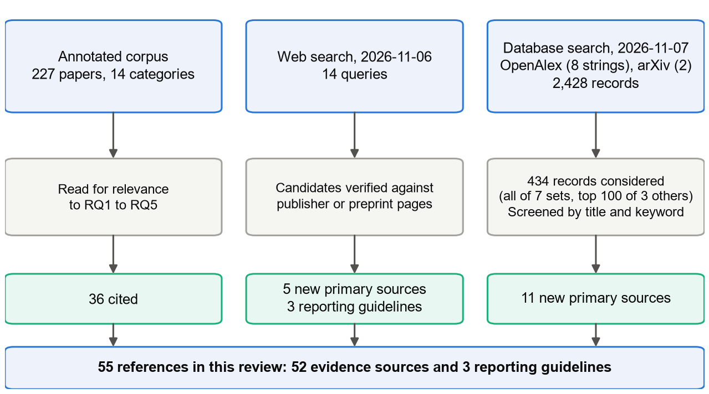
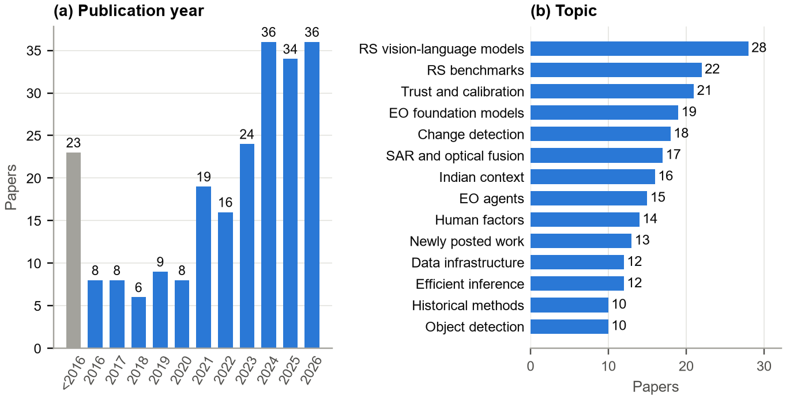
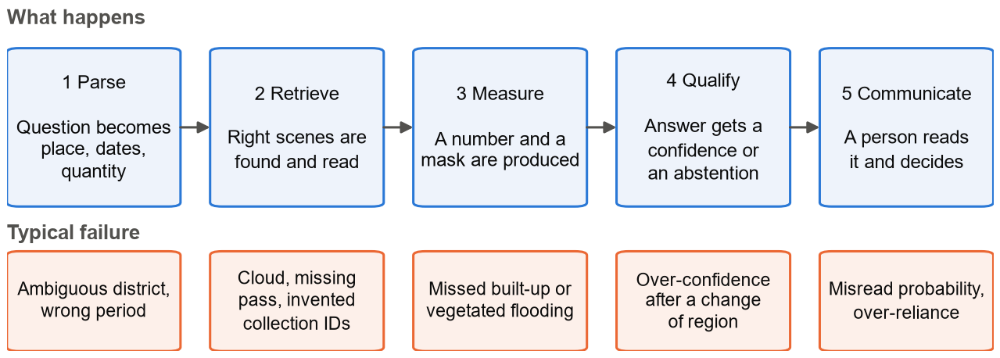
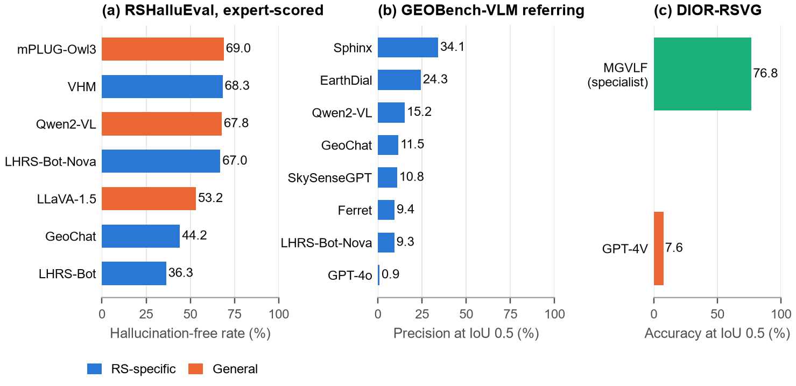
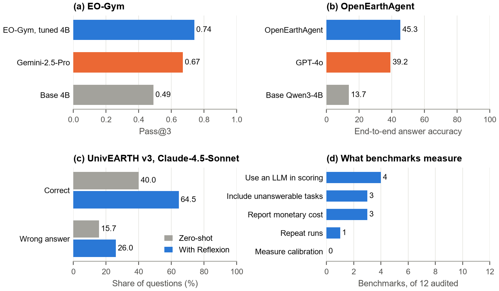
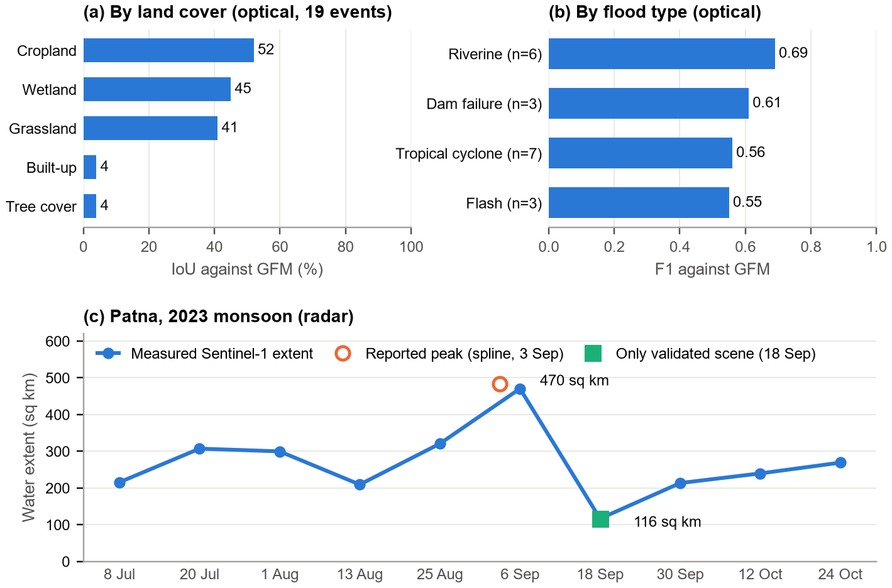

REVIEW ARTICLE

# Answering with evidence: a narrative review of trustworthy, language-driven Earth observation, with flood mapping as the test case

[Author names and affiliations to be added before submission] Searches conducted 6 and 7 November 2026. Draft, not peer reviewed.

## Abstract

Plain-language questions can now be put to satellite imagery, but whether an emergency manager can act on the answer to "how much land is flooded?" depends on far more than the language model. This narrative review examines what is known about making language-driven Earth observation (EO) answers trustworthy across language interfaces, measurement, uncertainty and human use, with Sentinel-1 flood mapping as the test case. An annotated corpus of 227 papers was supplemented by a targeted web search and by documented Boolean searches of OpenAlex and arXiv, adding 16 primary sources. Expert-judged hallucination-free rates for remote-sensing language models range from 36% to 69%. Tool-using agents improve accuracy, yet an audit of twelve agent benchmarks found that none measures calibration and only one repeats runs. Radar flood mapping largely misses flooded built-up areas, optical studies show strong land-cover limits, and the reference maps used for scoring disagree on definitions. Calibration, conformal risk control and abstention exist for flood segmentation, but they are tested at pixel level and mostly within the training distribution. Well-calibrated language-model probabilities have recently appeared for optical EO questions, although not for radar, floods or new regions. Confidence displays change how far people rely on AI without improving joint accuracy, and no user study of an EO question-answering assistant was found. The best-supported design keeps numbers out of the language model, verifies confidence in the region of use, abstains with a stated next step and records enough to replay the answer. The weakest evidence concerns cross-region calibration, answer-level evaluation and use by real decision-makers.

**Keywords:** Earth observation, vision-language models, flood mapping, Sentinel-1, calibration, conformal prediction, abstention, provenance, human-AI reliance

## 1 Introduction

Flood questions are local and urgent. Sentinel-1 radar observes through cloud and its data are free, but turning scenes into a defensible area figure requires geospatial skills that many local offices do not have. Language interfaces promise to close that gap, and a growing number of systems now accept plain-language questions about satellite imagery. The concern is that a fluent, confident and incorrect number will be acted upon. The important question is therefore not whether a model can produce an answer, but which design makes an answer safe to rely on and what a system should do when it is not.

This review addresses five research questions. RQ1 asks how reliable language models and agents are on EO questions that require a number or a location. RQ2 asks how reliable flood measurement from Sentinel-1 is and where it fails. RQ3 asks which methods provide a per-answer uncertainty and how well they survive a change of region. RQ4 asks what is known about how people use or misuse confidence displays in flood decisions. RQ5 asks what is known about making EO answers reproducible and auditable.

### 1.1 Scope and methodology of this review

This is a structured narrative review and does not claim PRISMA compliance. Its reporting was guided by the SANRA scale (Baethge et al., 2019) and by published guidance on narrative reviews (Green et al., 2006), and the PRISMA 2020 flow diagram (Page et al., 2021) was adapted to report selection.

Evidence came from three sources (Figure 1). The first was an annotated corpus of 227 papers in 14 categories, compiled before this review and weighted towards work since 2021 (Figure 2). Each entry records how and when it was verified. The second was a targeted web search on 6 November 2026, comprising 14 queries on areas the corpus covered weakly. The third was a documented Boolean search on 7 November 2026, using eight strings on OpenAlex titles and abstracts for 2023 to 2026 and two on arXiv, aimed specifically at the claims of absence made in this review. These searches returned 2,428 records before deduplication. All records in the seven smaller result sets were screened by title. For the three largest sets (139 to 1,100 records), only the 100 most relevant were considered, through a keyword filter. Search strings and counts are given in Supplementary Table S2.

Papers were included if they bore on RQ1 to RQ5, concerned EO or a directly transferable method, and could be verified against a publisher, preprint or portal page. Bibliographic details were checked against Crossref or the arXiv API, and the numbers cited from 11 corpus papers were rechecked against the arXiv text. Candidates that could not be verified were treated as leads and were not used as evidence (Supplementary Note 1). Depth of reading varies, and it is reported source by source in Supplementary Table S1 so that readers can weigh each claim accordingly. Many sources were read at abstract level, and full-text reading in the final pass targeted the cited claims rather than proceeding line by line.

The web search recalled poorly: the database search found 11 relevant sources that both it and the corpus had missed, six of them posted in the preceding ten weeks. Scopus, Web of Science and IEEE Xplore could not be searched, and this remains the largest gap in the method.

<figure>

<figcaption><strong>FIGURE 1.</strong> Literature identification and screening flow for this narrative review. Database records are not deduplicated across search strings.</figcaption>
</figure>

<figure>

<figcaption><strong>FIGURE 2.</strong> The 227-paper starting corpus by (a) publication year and (b) assigned topic. The 2026 count covers papers to the corpus cut-off in October.</figcaption>
</figure>

### 1.2 Conceptual framework: the answer chain

To compare papers that study very different things, a language-driven EO answer is divided here into five links, and each paper is placed by the link it studies (Figure 3). Overall reliability depends on all five working together, so a strong result at one link can be wasted by a weak one elsewhere. The literature is uneven across the chain. Parsing, retrieval and measurement attract most EO papers, qualification attracts fewer, and most of the work on communication and decisions (14 corpus papers, Figure 2) was not conducted on EO tasks at all.

<figure>

<figcaption><strong>FIGURE 3.</strong> The answer chain used to organise this review, with the typical failure at each link.</figcaption>
</figure>

## 2 Language models and agents

### 2.1 Reliability of the language layer

Language models perform poorly on tasks requiring location or count (Figure 4). GPT-4V reaches an intersection over union (IoU) of 0.5 for 7.6% of referents on the DIOR-RSVG referring task, against 76.8% for the supervised specialist MGVLF, and its damage-category counts on xBD fit poorly, with an R² of about 0.1 (Zhang and Wang, 2024). On GEOBench-VLM the best average multiple-choice accuracy is 41.7% against a 20% chance level, and the best referring-detection precision at IoU 0.5 is 34% (Danish et al., 2024). GeoChat reaches 10.6% on referring detection at the same threshold (Kuckreja et al., 2024), while the best model on VRSBench grounds 49.8% of referents (Li X. et al., 2024).

Hallucination is common. RSHallu reports expert-judged hallucination-free rates between 36.33% and 69.00%, with remote-sensing models performing no better than general ones and weakest on attributes such as modality and resolution (Zhou et al., 2026). RSHBench finds hallucinations in 47% to 61% of remote-sensing question-answering outputs, and a training-free attention-guided zoom brings one model down from 49.9% to 38.8% (Liu et al., 2026). VHM trains on deliberately deceptive questions about absent objects in order to teach refusal (Pang et al., 2025). Mitigation therefore helps, but it does not bring rates near what an official would want before acting.

Three independent families of benchmark point in the same direction, which supports a division of labour in which the language model parses and explains while instruments produce the numbers. The benchmarks are mostly high-resolution and optical, so absolute figures may not carry over to 10 m Sentinel-1 data. Even so, no benchmark was found in which a remote-sensing language model measures flooded area from Sentinel-1 to a tolerance that a disaster office would accept.

<figure>

<figcaption><strong>FIGURE 4.</strong> Reported language-model reliability on EO tasks. <strong>(a)</strong> Expert-scored hallucination-free rate on RSHalluEval (Zhou et al., 2026). <strong>(b)</strong> Referring-detection precision on GEOBench-VLM (Danish et al., 2024). <strong>(c)</strong> Referring accuracy on DIOR-RSVG (Zhang and Wang, 2024). Panels use different data sets and are not directly comparable.</figcaption>
</figure>

### 2.2 Agents and tool use

Moving the number into code or tools improves results (Figure 5). In EO-Gym, a LoRA-tuned 4B model learns to fetch older scenes and to switch between optical and SAR, reaching 0.74 Pass@3 against 0.49 for its base and 0.67 for Gemini-2.5-Pro (Ma et al., 2026). OpenEarthAgent reports end-to-end accuracy of 45.26 against 13.72 for its base and 39.22 for GPT-4o, using replay-validated tool traces (Shabbir et al., 2026).

Live data access remains brittle. On version 3 of UnivEARTH (408 questions), the best zero-shot accuracy is 40.0%, generated Earth Engine code fails more than 44% of the time, and collection identifiers are invented. A Reflexion loop, which feeds failures back to the model, lifts the best model to 64.5%, but its wrong-answer rate also rises from 15.7% to 26.0% (Kao et al., 2026). The earlier 140-question versions report 33% accuracy and 58% code failures, so the version matters when citing this benchmark. A position paper argues that reprojection, resampling and compositing silently alter data so that errors propagate, and that EO agents need verifiers, structured geospatial state and evaluation beyond accuracy, although it proposes no system or benchmark (Munir et al., 2026).

Reliability is rarely what these benchmarks score. A 2026 survey identifies calibration, abstention and validated operational use as missing (Pan et al., 2026), and a recent review describes LLM-as-judge scoring as widely reported without calibration against human experts (Alheejawi and Gruzauskas, 2026). Angelidis et al. (2026) quantify the gap. In an unreviewed audit of twelve agent benchmarks, one repeats runs, three include unanswerable tasks and none measures calibration. Their re-analysis of published tables finds that capability does not predict abstention, and that task success can exceed tool-call correctness by up to 54 points on identical queries. They conclude that current evidence justifies assistive roles only. Tool use appears necessary, but the evidence does not show that it is sufficient.

<figure>

<figcaption><strong>FIGURE 5.</strong> Reported effects of tool use, and what agent benchmarks measure. <strong>(a)</strong> EO-Gym (Ma et al., 2026). <strong>(b)</strong> OpenEarthAgent (Shabbir et al., 2026). <strong>(c)</strong> UnivEARTH version 3 (Kao et al., 2026). <strong>(d)</strong> Audit of twelve agent benchmarks (Angelidis et al., 2026).</figcaption>
</figure>

## 3 Measuring floods from radar

### 3.1 Methods and failure modes

The methods are mature. The baselines include rule-based chains using Otsu-type thresholding with slope and height-above-nearest-drainage refinement (Twele et al., 2016), Bayesian per-pixel flood probability (Giustarini et al., 2016; Bauer-Marschallinger et al., 2022), and the Copernicus Global Flood Monitoring (GFM) product, which combines three algorithms by majority vote and gives each flood pixel a likelihood of 0 to 100 derived from their uncertainty outputs (Krullikowski et al., 2023). A dual-polarised convolutional network outperformed an operational rule chain by about 5 IoU points (Bereczky et al., 2022).

The failure modes are also well described. Intensity-based networks largely miss flooded built-up areas, and interferometric coherence helps (Pulvirenti et al., 2016; Chini et al., 2019; Zhao et al., 2024). GFM's likelihood proved only roughly reliable in a single-site check (Krullikowski et al., 2023). The widest recent evaluation comes from optical data: Kolluru et al. (2026) ran Prithvi-EO-2.0 on 19 unseen events using HLS imagery and scored it against GFM (Figures 6a, b). IoU was 52% on cropland but about 4% on tree cover and built-up areas, and F1 was 0.69 for riverine floods. The authors attribute part of the apparent error to inconsistent definitions across two reference products, and they report 23 pipeline failure modes. These land-cover limits apply to radar only by analogy, because the physical causes differ. The reference problem carries over directly, since GFM is itself a Sentinel-1 product.

A single global accuracy figure therefore under-describes the risk. Accuracy varies with land cover and flood type, so any uncertainty estimate probably needs to be conditioned on both, and disagreement over what counts as flooded places a ceiling on every score regardless of the model.

### 3.2 Evidence from Indian floods

Monsoon conditions make South Asia a demanding test, but the available evidence is small-scale and difficult to compare. Soudagar and Thakur (2025) apply Otsu thresholding to Sentinel-1 in Google Earth Engine for the 2023 flood in Patna (Figure 6c). Their reported peak of 484.13 km² on 3 September comes from a spline through 12-day captures, whereas the highest measured extent is 470.27 km² on 6 September. Validation is a single comparison against a same-day PlanetScope reference on 18 September, when measured extent had fallen to 116.31 km². It gives an overall accuracy of 93.10% and an F1 of 0.8416, with precision of 0.9853 and recall of 0.7345. The only validated scene is thus a receded one, and about a quarter of the reference water was still missed. This shows that the method can work on a clean scene, but it says little about peak-monsoon, cloudy, vegetated or urban conditions, where optical references are scarce.

The reference data themselves can be out of reach. For the 2021 Mahad flood, Khobragade et al. (2026, unreviewed) could not obtain event data from the National Remote Sensing Centre (NRSC) through public routes, so they georeferenced a screenshot of the Bhuvan portal layer. Their Sentinel-1 mask matched it at an IoU of 36.85%, a value they explicitly decline to describe as accuracy, while two threshold choices on the same scenes agreed with each other at an IoU of 0.867.

<figure>

<figcaption><strong>FIGURE 6.</strong> Limits of flood mapping. <strong>(a, b)</strong> Prithvi-EO-2.0 on optical HLS imagery against GFM, by land cover and flood type (Kolluru et al., 2026). <strong>(c)</strong> Sentinel-1 water extent for Patna, 2023, showing that the validated scene falls after the flood had receded (Soudagar and Thakur, 2025).</figcaption>
</figure>

## 4 Qualifying answers: calibration, conformal methods and abstention

### 4.1 Established foundations

The basics are settled. Modern networks are over-confident, and a single temperature fitted on held-out data repairs much of the error (Guo et al., 2017). Selective classification trades coverage for risk with a statistical guarantee (Geifman and El-Yaniv, 2017). Conformal methods provide label sets with finite-sample coverage (Angelopoulos et al., 2021), and conformal risk control extends the guarantee to losses such as missed flood area (Angelopoulos et al., 2024; Mossina et al., 2024). Deep ensembles offer a simple spread-based uncertainty (Lakshminarayanan et al., 2017). All of these degrade under dataset shift (Ovadia et al., 2019).

### 4.2 Application to flood mapping

Five recent studies apply such methods to floods (Table 1), and only three of them use radar. The closest published match to calibrated abstention for SAR floods is Li et al. (2026), who expose model-knowledge and data uncertainty through conformal risk control at a user-chosen risk level. Its abstract reports out-of-distribution (OOD) detection AUROC of 0.921, against 0.684 for Bayesian networks and 0.603 for deep ensembles. Average water false-negative rate falls from 36.9% to 28.5% when OOD inputs are abstained, and average miscoverage falls from 4.4% to 1.6% against singleton predictions. The abstract does not state whether the tests cross regions. Ludwig and Hänsch (2025), in contrast, find that nearly all post-hoc uncertainty methods for SAR flood detection, including the softmax baseline, give rather similar results. These two findings sit in some tension. The designs differ and both were read at abstract level, so this review cannot reconcile them.

**TABLE 1.** Uncertainty and abstention methods applied to flood mapping.

| Study | Sensor | Approach | Main finding | Limit for this question |
|---|---|---|---|---|
| Li et al. (2026) | SAR | Density-aware network with conformal risk control and OOD abstention | OOD AUROC 0.921; water false negatives 36.9% to 28.5% | Abstract only; regional design not stated |
| Ludwig and Hänsch (2025) | SAR | Comparison of post-hoc uncertainty methods | Student ensembles best by a small margin; most methods similar | Abstract only; no abstention tested |
| Novikov et al. (2026) | SAR | Temporal augmentation with conformal prediction, region-based cross-validation | Mean IoU about 0.61 to 0.69; prediction sets slightly larger | Pixel level; no coverage by region reported in the abstract |
| Konidakis et al. (2025) | Optical | Inductive conformal prediction against CV+ | CV+ balances calibration and data use better when data are scarce | Abstract gives no numbers |
| Gonzalez-Calabuig et al. (2026) | Optical | Decision tree over OOD scores and ensemble uncertainty | Lower risk on retained tiles | Output uncalibrated; generic next step |

### 4.3 Transfer across regions

Shift is the open problem. Ovadia et al. (2019) establish the degradation in general, and EO-Jev lists calibration away from the training distribution among its unresolved problems (Abouelhadid et al., 2026). Neither search found a published paper that tests conformal or calibrated SAR flood answers leave-one-region-out and reports answer-level coverage alongside. Novikov et al. (2026) come closest, across seven Russian regions, but at pixel level. Ratté-Fortin et al. (2026) and Hosch and Dasgupta (2026) test how SAR flood mapping transfers across hydro-climatic regimes and biomes, although their abstracts report accuracy rather than confidence.

### 4.4 Language models as a source of confidence

This area has changed quickly. Tian et al. (2023) found that, for general text question answering, verbalised confidences from RLHF-tuned models are usually better calibrated than token probabilities, often halving expected calibration error (ECE) in relative terms. Two preprints posted in November 2026 carry a related idea into EO by reading probabilities over fixed answer options, with no generated text. EarthJev reports an ECE of 0.006 on template questions about Sentinel-2 land cover and states that behaviour outside the training distribution is untested (Benfenati et al., 2026). EO-Jev reports lower ECE than specialist models on 21 of 28 settings across 23 public benchmarks, while excluding SAR inputs and listing counting on unseen imagery among what remains difficult (Abouelhadid et al., 2026). A caution comes from RSAJEV, in which this kind of confidence inverts on out-of-vocabulary weights, scoring unseen classes above seen ones with an AUROC of 0.38 (Chen et al., 2026).

Calibrated language-model probabilities on EO questions therefore now exist. None of this work covers radar, floods, numeric answers or a change of region, and the quantity of interest here is an instrument measurement rather than a recalled fact. For that case, no evidence yet supports the language model as the source of confidence.

### 4.5 Evaluation design

Pixel metrics such as IoU and F1 and answer metrics, such as whether a published area falls within tolerance of a reference, measure different things. An abstaining system needs the second kind, together with coverage reported by region. This is the most significant design gap in the literature reviewed here.

## 5 People and decisions

Showing an AI's confidence led people to rely on it more when it was confident, but joint accuracy did not rise, and SHAP-style explanations did not help calibration (Zhang et al., 2020). Cognitive forcing, in which people commit to their own judgement first, reduces blind acceptance but is disliked (Buçinca et al., 2021). Explanations reduce over-reliance only when they make checking cheaper than trusting (Vasconcelos et al., 2023).

For flood maps, Jean et al. (2023) interviewed 140 respondents across government, municipalities, agencies, citizens and farmers. Exceedance probabilities were difficult to grasp, depth and level were confused, and preferences varied by group, although all groups found words and numbers useful together. That study concerns hydrological forecasting in Quebec rather than satellite flood extent, so its transfer is limited.

No study of a language-driven EO assistant with real decision-makers was found in the web search or among the 100 most relevant of 1,100 database records. What transfers from adjacent work is modest: confidence displays shift reliance rather than accuracy, wording and map design matter, and audiences differ. This supports showing extent first, using plain wording and making verification cheap. It does not support the claim that abstention improves real decisions, which remains untested.

## 6 Reproducibility and audit

Standards for reproducible EO exist, including openEO and CEOS Analysis Ready Data (Schramm et al., 2021; CEOS, 2026). Omidi et al. (2025) integrate a provenance library into openEO following W3C PROV and demonstrate it on a Sentinel-1 flood-mapping workflow, without evaluating overhead, latency or accuracy. OpenEarthAgent caches and replays tool traces (Shabbir et al., 2026). SeaScope tracks provenance in a natural-language-to-Earth-Engine framework for maritime monitoring, and its abstract claims reproducibility without reporting a re-run test (Sekas et al., 2026). The audit by Angelidis et al. (2026) found only one benchmark of twelve repeating runs. No EO study was found that measures whether a published answer re-runs to identical output, although only the 100 most relevant of 1,055 database records were screened on this point.

## 7 Synthesis

### 7.1 Strength of the evidence

Table 2 summarises the main claims. The strongest evidence concerns the weakness of language models on measurement, while the claims most relevant to deployment rest on few sources.

**TABLE 2.** Main claims and the strength of evidence supporting them.

| Claim | Principal sources | Strength |
|---|---|---|
| Remote-sensing language models are unreliable for counts, locations and sensor facts | Zhang and Wang (2024); Danish et al. (2024); Zhou et al. (2026); Liu et al. (2026) | Strong, mostly optical |
| Moving numbers into tools raises answer accuracy | Ma et al. (2026); Shabbir et al. (2026); Kao et al. (2026) | Moderate; correctness only, runs rarely repeated |
| Radar flood mapping largely misses flooded built-up areas | Pulvirenti et al. (2016); Chini et al. (2019); Zhao et al. (2024) | Moderate to strong |
| Land cover and flood type limit flood mapping generally | Kolluru et al. (2026) | Moderate for optical, indirect for radar |
| Conformal risk control with OOD abstention reduces SAR flood misses | Li et al. (2026); compare Ludwig and Hänsch (2025) | Single source, abstract only, some tension |
| Language-model probabilities can be calibrated on EO questions | Benfenati et al. (2026); Abouelhadid et al. (2026) | Weak; new preprints, optical, in-distribution |
| Calibration degrades in a new region | Ovadia et al. (2019); Abouelhadid et al. (2026) | General evidence; not established for SAR floods |
| Showing confidence changes reliance, not accuracy | Zhang et al. (2020); Buçinca et al. (2021); Vasconcelos et al. (2023) | Moderate; non-EO tasks |
| EO answers can be made replayable | Omidi et al. (2025); Shabbir et al. (2026) | Weak; no independent measurement |

### 7.2 Disagreements and counter-evidence

The argument for keeping numbers out of the language model could weaken as models improve. Pixel-grounded models such as TerraScope interleave masks into their reasoning and report 68.9 on average against 43.3 for the best zero-shot model, on their own benchmark (Shu et al., 2026). Should such a model reach reliable area measurement on Sentinel-1, the case for separation would weaken considerably, and this has been neither shown nor ruled out. EO-Jev and EarthJev strengthen this side of the argument on confidence but not on measurement, since both remain limited to fixed answer options.

Abstention is the hardest issue to settle. If a system declines when its confidence is low, fewer wrong figures are published, and Li et al. (2026) report a corresponding reduction in the false-negative rate. Selective classification, however, always exchanges risk against coverage (Geifman and El-Yaniv, 2017), and the flood studies reviewed here report pixel-level risk rather than the share of questions left unanswered. For an official during a flood, "no answer, and here is what to try next" may be acceptable for some questions and a plain failure for others, and nothing in the literature indicates which. The coverage cost also depends on a threshold, and the threshold depends on a calibration that is known to degrade under shift. Two readings follow. In one, abstention is simply the price of honesty, and officials should accept it. In the other, a system that withholds most answers will be abandoned for a worse tool that always answers, in which case abstention lowers reliability in practice. The second reading is speculative but not obviously wrong, and only a study with real users can separate them.

Prioritising the answer over the pixel is itself a framing choice. Many papers improve IoU by a few points, and a trust-focused view instead places answer-level error and coverage first. This review adopts that view, but it is a position rather than an established finding.

Finally, the absence of a competing system should be read cautiously. Neither search found an end-to-end assistant that publishes calibrated, region-checked, abstaining flood answers, but the database search changed the picture on language-model confidence, quantified the benchmark gap and added counter-evidence on OOD methods. Given how much the first search had missed, this remains weak evidence of absence.

## 8 Gaps, limitations and future directions

### 8.1 Research gaps

Five gaps stand out. The first is leave-one-region-out evaluation of calibrated or conformal SAR flood answers, with coverage reported by region. The second is answer-level evaluation, meaning area within tolerance of a reference, for any language-driven EO system. The third is any user study of a language-driven EO assistant with real decision-makers. The fourth is an independent test of whether EO answers replay deterministically. The fifth is a Sentinel-1 flood reference set for Indian events beyond the Sen1Floods11 chips, with peak-monsoon labels and public access to national event data (Khobragade et al., 2026). A related disagreement remains unresolved, namely that definitions of flood (permanent water, floodplain, wet paddy) differ across reference products (Kolluru et al., 2026).

### 8.2 Limitations of this review

Several limitations should be acknowledged. First, the search relied on a general web tool of unknown recall and on open databases screened mainly by title, with only the top 100 records of the three largest result sets considered, and without Scopus, Web of Science or IEEE Xplore. Second, depth of reading is uneven (Supplementary Table S1). Li et al. (2026) matters most here, as the publisher site refused automated access and its figures come from the abstract as read on 6 November 2026, without a second check. Figures from Bereczky et al. (2022) and Krullikowski et al. (2023) were not rechecked against the papers. Third, one person is responsible for selection and appraisal, with no independent second human reviewer, and an AI assistant carried out much of the search and extraction. Fourth, many 2026 sources are unreviewed preprints, two of them posted within a week of the search. Fifth, the scope is floods and Sentinel-1, and the framework may not transfer to crops, optical land cover or very high-resolution tasks. Finally, the field moves monthly, and a single new paper could overturn parts of Section 7.2.

### 8.3 Future directions

Eight priorities follow from this review.

1. Test conformal risk control against threshold abstention by leave-one-event-out and leave-one-region-out designs on Sen1Floods11, Kuro Siwo and new regional labels.
2. Label further Indian events at peak monsoon, which would strengthen the evidence on calibration transfer more than any other single step.
3. Define an answer-level benchmark covering question, place, dates, reference area, tolerance and publish-or-abstain, scored on error among published answers and on coverage by region.
4. Run the same questions through a pixel-grounded language model and through an instrument pipeline, and compare error and calibration.
5. Test verbalised and decision-model confidence on EO numeric answers and on radar, across regions, against instrument-derived confidence.
6. Condition uncertainty on land cover and flood type, treating the optical limits in Kolluru et al. (2026) as a hypothesis to check on radar.
7. Conduct a user study with officials and journalists comparing a number alone, a number with confidence and a number with abstention and a next step, measuring joint decision accuracy and reliance.
8. Publish a replay-determinism protocol that any EO assistant can run.

## 9 Conclusion

The evidence reviewed here supports a design more than a result. Numbers should come from instruments whose failure modes are known rather than from the language layer, confidence should be verified in the region where it is used, abstention should come with a stated next step, and enough should be recorded to replay the answer. The failure of the language layer on numbers is well established, and the case for tools is partly established. Calibrated language-model probabilities on optical EO questions are new, and they are the development most likely to change this picture. Whether calibrated abstention survives a change of region, and whether it improves real decisions, remain hypotheses, and these are the two most useful things to test next.

## Statements

**Author contributions.** [To be completed by the author before submission.]

**Funding.** [To be confirmed by the author before submission.]

**Conflict of interest.** The annotated corpus used as a starting point was compiled during the development of EvidEO, an open-source flood question-answering system. EvidEO and its results were deliberately excluded from this review. [The author to confirm their relationship to EvidEO and declare any other interests before submission.]

**Generative AI statement.** Claude (Anthropic) was used to draft parts of the text, run the searches, fetch and extract from sources, check figures against sources, generate the figures and edit the manuscript. The database search of 7 November 2026, its screening and the assigned reading depths were carried out by the assistant and require the author's review. The author is responsible for the final content.

**Data availability.** The annotated corpus and the code and data for all figures are available at https://github.com/UnKnownnPasta/EvidEO.

## References

Abouelhadid, M. A., Abuhani, D. A., Munir, M. A., Khan, F. S., and Khan, S. (2026). EO-Jev: decision model for Earth observation. *arXiv*. https://arxiv.org/abs/2611.03371

Alheejawi, S., and Gruzauskas, V. (2026). Agentic large language model workflows for Earth observation: tool orchestration, foundation-model adaptation, and the evaluation gap. *EarthArXiv*. https://doi.org/10.31223/X5TN59

Angelidis, G., Psiris, A., Evangelatos, S., Lagkas, T., Sarigiannidis, P., Varlamis, I., et al. (2026). Trust before autonomy: rethinking agentic remote sensing for crisis response. *arXiv*. https://arxiv.org/abs/2610.18789

Angelopoulos, A., Bates, S., Malik, J., and Jordan, M. I. (2021). Uncertainty sets for image classifiers using conformal prediction. *ICLR 2021*. https://arxiv.org/abs/2009.14193

Angelopoulos, A. N., Bates, S., Fisch, A., Lei, L., and Schuster, T. (2024). Conformal risk control. *ICLR 2024*. https://arxiv.org/abs/2208.02814

Baethge, C., Goldbeck-Wood, S., and Mertens, S. (2019). SANRA, a scale for the quality assessment of narrative review articles. *Res. Integr. Peer Rev.* 4, 5. https://doi.org/10.1186/s41073-019-0064-8

Bauer-Marschallinger, B., Cao, S., Tupas, M. E., Roth, F., Navacchi, C., Melzer, T., et al. (2022). Satellite-based flood mapping through Bayesian inference from a Sentinel-1 SAR datacube. *Remote Sens.* 14 (15), 3673. https://doi.org/10.3390/rs14153673

Benfenati, D., Rinaldi, A. M., and Tommasino, C. (2026). EarthJev: calibrated, non-generative answers to natural-language questions about Sentinel-2 land cover. *arXiv*. https://arxiv.org/abs/2611.02096

Bereczky, M., Wieland, M., Krullikowski, C., Martinis, S., and Plank, S. (2022). Sentinel-1-based water and flood mapping: benchmarking convolutional neural networks against an operational rule-based processing chain. *IEEE J. Sel. Top. Appl. Earth Obs. Remote Sens.* 15, 2023-2036. https://doi.org/10.1109/JSTARS.2022.3152127

Buçinca, Z., Malaya, M. B., and Gajos, K. Z. (2021). To trust or to think: cognitive forcing functions can reduce overreliance on AI in AI-assisted decision-making. *Proc. ACM Hum.-Comput. Interact.* 5 (CSCW1), 1-21. https://doi.org/10.1145/3449287

CEOS (2026). CEOS-ARD product family specification: synthetic aperture radar, version 1.3.1. Committee on Earth Observation Satellites. https://ceos.org/ard/files/PFS/SAR/v1.3.1/CEOS-ARD_PFS_SAR_v1.3.1.pdf

Chen, M., Chen, A., Xu, S., Gu, C., Zhou, H., Sun, K., et al. (2026). RSAJEV: training-free abstaining prototype memory for eliminating silent hallucination in JEV-based remote sensing classification. *arXiv*. https://arxiv.org/abs/2610.15742

Chini, M., Pelich, R., Pulvirenti, L., Pierdicca, N., Hostache, R., and Matgen, P. (2019). Sentinel-1 InSAR coherence to detect floodwater in urban areas: Houston and Hurricane Harvey as a test case. *Remote Sens.* 11 (2), 107. https://doi.org/10.3390/rs11020107

Danish, M. S., Munir, M. A., Shah, S. R. A., Kuckreja, K., Khan, F. S., Fraccaro, P., et al. (2024). GEOBench-VLM: benchmarking vision-language models for geospatial tasks. *arXiv*. https://arxiv.org/abs/2411.19325

Geifman, Y., and El-Yaniv, R. (2017). Selective classification for deep neural networks. *NeurIPS 2017*. https://arxiv.org/abs/1705.08500

Giustarini, L., Hostache, R., Kavetski, D., Chini, M., Corato, G., Schlaffer, S., et al. (2016). Probabilistic flood mapping using synthetic aperture radar data. *IEEE Trans. Geosci. Remote Sens.* 54 (12), 6958-6969. https://doi.org/10.1109/TGRS.2016.2592951

Gonzalez-Calabuig, M., Cohrs, K.-H., Nedungadi, V., Osika, Z., Cartuyvels, R., Knoblauch, S., et al. (2026). SHRUG-FM: reliability-aware foundation models for Earth observation. *CVPR 2026 EarthVision Workshop*. https://arxiv.org/abs/2511.10370

Green, B. N., Johnson, C. D., and Adams, A. (2006). Writing narrative literature reviews for peer-reviewed journals: secrets of the trade. *J. Chiropr. Med.* 5 (3), 101-117. https://doi.org/10.1016/S0899-3467(07)60142-6

Guo, C., Pleiss, G., Sun, Y., and Weinberger, K. Q. (2017). On calibration of modern neural networks. *ICML 2017*. https://arxiv.org/abs/1706.04599

Hosch, P. C., and Dasgupta, A. (2026). Cross-biome transferability of SAR-based flood mapping with random forests. *EGU General Assembly 2026*, EGU26-1092. https://doi.org/10.5194/egusphere-egu26-1092

Jean, V., Boucher, M.-A., Frini, A., and Roussel, D. (2023). Uncertainty in three dimensions: the challenges of communicating probabilistic flood forecast maps. *Hydrol. Earth Syst. Sci.* 27, 3351-3373. https://doi.org/10.5194/hess-27-3351-2023

Kao, C. H., Zhao, W., Lam, C., Umap, A., Revankar, S., Speas, S., et al. (2026). Towards LLM agents for Earth observation. *Findings of ACL 2026*. https://arxiv.org/abs/2504.12110

Khobragade, S., Mulani, K., and Varekar, D. (2026). Threshold sensitivity and reference uncertainty in Sentinel-1 inundation mapping: the July 2021 Mahad flood. *EarthArXiv*. https://doi.org/10.31223/X5NZ33

Kolluru, V., Shinde, R., Marouane, A., Helbling, C., Shah, D., Drew, O., et al. (2026). Land cover and flood type govern the detection limits of satellite-based flood mapping across diverse global flood events. *arXiv*. https://arxiv.org/abs/2606.07780

Konidakis, I., Panayidou, K., Tsagkatakis, G., and Tsakalides, P. (2025). Uncertainty-aware flood segmentation from Sentinel 2 observations with conformal prediction. *IGARSS 2025*, 2116-2120. https://doi.org/10.1109/IGARSS55030.2025.11242848

Krullikowski, C., Chow, C., Wieland, M., Martinis, S., Bauer-Marschallinger, B., Roth, F., et al. (2023). Estimating ensemble likelihoods for the Sentinel-1-based Global Flood Monitoring product of the Copernicus Emergency Management Service. *IEEE J. Sel. Top. Appl. Earth Obs. Remote Sens.* 16, 6917-6930. https://doi.org/10.1109/JSTARS.2023.3292350

Kuckreja, K., Danish, M. S., Naseer, M., Das, A., Khan, S., and Khan, F. S. (2024). GeoChat: grounded large vision-language model for remote sensing. *CVPR 2024*. https://arxiv.org/abs/2311.15826

Lakshminarayanan, B., Pritzel, A., and Blundell, C. (2017). Simple and scalable predictive uncertainty estimation using deep ensembles. *NeurIPS 2017*. https://arxiv.org/abs/1612.01474

Li, X., Ding, J., and Elhoseiny, M. (2024). VRSBench: a versatile vision-language benchmark dataset for remote sensing image understanding. *NeurIPS 2024 Datasets and Benchmarks Track*. https://arxiv.org/abs/2406.12384

Li, Y., Matgen, P., and Chini, M. (2026). Quantifying and communicating uncertainty in SAR-based flood mapping via density-aware neural networks and conformal risk control. *IEEE Trans. Geosci. Remote Sens.* 64, 4202520. https://doi.org/10.1109/TGRS.2026.3661208

Liu, Y., Zhang, J., Wang, D., Tian, X., Guo, H., and Du, B. (2026). Seeing clearly without training: mitigating hallucinations in multimodal LLMs for remote sensing. *arXiv*. https://arxiv.org/abs/2603.02754

Ludwig, J., and Hänsch, R. (2025). Evaluation of post hoc uncertainty quantification approaches for flood detection from SAR imagery. *IEEE J. Sel. Top. Appl. Earth Obs. Remote Sens.* 18, 15209-15221. https://doi.org/10.1109/JSTARS.2025.3577690

Ma, S., Li, Z., Li, S., Xu, X., Zhu, R., Boston, T., et al. (2026). EO-Gym: a multimodal, interactive environment for Earth observation agents. *arXiv*. https://arxiv.org/abs/2605.01250

Mossina, L., Dalmau, J., and Andéol, L. (2024). Conformal semantic image segmentation: post-hoc quantification of predictive uncertainty. *CVPR 2024 Workshops*, 3574-3584. https://arxiv.org/abs/2405.05145

Munir, M. A., Sheikh, M. U., Shabbir, A., Khan, M. H., Khan, F., Zhu, X. X., et al. (2026). Agentic AI for remote sensing: technical challenges and research directions. *arXiv*. https://arxiv.org/abs/2604.24919

Novikov, I., Illarionova, S., Shadrin, D., and Burnaev, E. (2026). SAR data temporal augmentation for cross-regional flood monitoring. *ICETIS 2026*, 487-492. https://doi.org/10.1109/ICETIS70504.2026.11633428

Omidi, H., Sacco, L., Hutter, V., Irsiegler, G., Claus, M., Schobben, M., et al. (2025). Towards provenance-aware Earth observation workflows: the openEO case study. *IEEE International Conference on eScience*. https://doi.org/10.1109/eScience65000.2025.00016

Ovadia, Y., Fertig, E., Ren, J., Nado, Z., Sculley, D., Nowozin, S., et al. (2019). Can you trust your model's uncertainty? Evaluating predictive uncertainty under dataset shift. *NeurIPS 2019*. https://arxiv.org/abs/1906.02530

Page, M. J., McKenzie, J. E., Bossuyt, P. M., Boutron, I., Hoffmann, T. C., Mulrow, C. D., et al. (2021). The PRISMA 2020 statement: an updated guideline for reporting systematic reviews. *J. Clin. Epidemiol.* 134, 178-189. https://doi.org/10.1016/j.jclinepi.2021.03.001

Pan, J., Yao, L., Zhang, Z., Zheng, Y., Li, J., He, X., et al. (2026). From perception to reasoning in remote sensing: a survey and outlook. *Preprints.org*. https://www.preprints.org/manuscript/202608.1840

Pang, C., Weng, X., Wu, J., Li, J., Liu, Y., Sun, J., et al. (2025). VHM: versatile and honest vision language model for remote sensing image analysis. *AAAI 2025*. https://arxiv.org/abs/2403.20213

Pulvirenti, L., Chini, M., Pierdicca, N., and Boni, G. (2016). Use of SAR data for detecting floodwater in urban and agricultural areas: the role of the interferometric coherence. *IEEE Trans. Geosci. Remote Sens.* 54 (3), 1532-1544. https://doi.org/10.1109/TGRS.2015.2482001

Ratté-Fortin, C., Chokmani, K., and Turcotte, R. (2026). A transferable deep learning framework for flood mapping: spatial generalization across hydro-climatic regimes using satellite imagery. *Int. J. Appl. Earth Obs. Geoinf.* 149, 105321. https://doi.org/10.1016/j.jag.2026.105321

Schramm, M., Pebesma, E., Milenković, M., Foresta, L., Dries, J., Jacob, A., et al. (2021). The openEO API: harmonising the use of Earth observation cloud services using virtual data cube functionalities. *Remote Sens.* 13 (6), 1125. https://doi.org/10.3390/rs13061125

Sekas, C., Mavrofidopoulou, L., Agathangelidis, I., Cartalis, C., Philippopoulos, K., Mavroudis, F., et al. (2026). SeaScope: a transparent and reproducible LLM-assisted framework for maritime Earth observation analysis. *Remote Sens.* 18 (17), 2849. https://doi.org/10.3390/rs18172849

Shabbir, A., Sheikh, M. U., Munir, M. A., Debary, H., Fiaz, M., Zaheer, M. Z., et al. (2026). OpenEarthAgent: a unified framework for tool-augmented geospatial agents. *ECCV 2026*. https://arxiv.org/abs/2602.17665

Shu, Y., Ren, B., Xiong, Z., Zhu, X. X., Demir, B., Sebe, N., et al. (2026). TerraScope: pixel-grounded visual reasoning for Earth observation. *CVPR 2026*. https://arxiv.org/abs/2603.19039

Soudagar, R., and Thakur, A. K. (2025). Quantifying spatiotemporal variability of Patna's 2023 monsoon flood using Sentinel-1 SAR data and Moran's Index. *Int. Arch. Photogramm. Remote Sens. Spatial Inf. Sci.* XLVIII-G-2025, 1367-1372. https://doi.org/10.5194/isprs-archives-XLVIII-G-2025-1367-2025

Tian, K., Mitchell, E., Zhou, A., Sharma, A., Rafailov, R., Yao, H., et al. (2023). Just ask for calibration: strategies for eliciting calibrated confidence scores from language models fine-tuned with human feedback. *EMNLP 2023*. https://arxiv.org/abs/2305.14975

Twele, A., Cao, W., Plank, S., and Martinis, S. (2016). Sentinel-1-based flood mapping: a fully automated processing chain. *Int. J. Remote Sens.* 37 (13), 2990-3004. https://doi.org/10.1080/01431161.2016.1192304

Vasconcelos, H., Jörke, M., Grunde-McLaughlin, M., Gerstenberg, T., Bernstein, M. S., and Krishna, R. (2023). Explanations can reduce overreliance on AI systems during decision-making. *Proc. ACM Hum.-Comput. Interact.* 7 (CSCW1), 1-38. https://doi.org/10.1145/3579605

Zhang, C., and Wang, S. (2024). Good at captioning, bad at counting: benchmarking GPT-4V on Earth observation data. *CVPR 2024 Workshops (EarthVision)*, 7839-7849. https://arxiv.org/abs/2401.17600

Zhang, Y., Liao, Q. V., and Bellamy, R. K. E. (2020). Effect of confidence and explanation on accuracy and trust calibration in AI-assisted decision making. *FAT\* 2020*. https://doi.org/10.1145/3351095.3372852

Zhao, J., Xiong, Z., and Zhu, X. X. (2024). UrbanSARFloods: Sentinel-1 SLC-based benchmark dataset for urban and open-area flood mapping. *CVPR 2024 Workshops (EarthVision)*. https://arxiv.org/abs/2406.04111

Zhou, Z., Feng, Y., Chen, Y., Duan, G., Song, Z., Zhou, M., et al. (2026). RSHallu: dual-mode hallucination evaluation for remote-sensing multimodal large language models with domain-tailored mitigation. *arXiv*. https://arxiv.org/abs/2602.10799

## Supplementary material

**Supplementary Table S1.** Depth at which each evidence source was read. *Full*: numbers read from the body or tables. *Partial*: part of the full text, or full text through a summarising tool. *Abstract*: abstract, metadata or landing page only. Status is as far as could be established; "preprint" means no peer-reviewed venue was found.

| Depth | Status | Sources |
|---|---|---|
| Full | Peer-reviewed venue | Danish et al. (2024, venue per project README); Gonzalez-Calabuig et al. (2026); Jean et al. (2023); Kao et al. (2026); Krullikowski et al. (2023); Kuckreja et al. (2024); Li X. et al. (2024); Omidi et al. (2025); Pang et al. (2025); Shabbir et al. (2026); Shu et al. (2026); Soudagar and Thakur (2025); Tian et al. (2023); Zhang and Wang (2024) |
| Full | Preprint | Abouelhadid et al. (2026); Angelidis et al. (2026); Benfenati et al. (2026); Kolluru et al. (2026, main text); Ma et al. (2026); Munir et al. (2026); Zhou et al. (2026) |
| Partial | Peer-reviewed venue | Mossina et al. (2024); Schramm et al. (2021); Zhang et al. (2020) |
| Partial | Preprint | Liu et al. (2026); Pan et al. (2026) |
| Abstract | Peer-reviewed venue | Angelopoulos et al. (2021, 2024); Bauer-Marschallinger et al. (2022); Bereczky et al. (2022); Buçinca et al. (2021); CEOS (2026, specification); Chini et al. (2019); Geifman and El-Yaniv (2017); Giustarini et al. (2016); Guo et al. (2017); Konidakis et al. (2025); Lakshminarayanan et al. (2017); Li Y. et al. (2026); Ludwig and Hänsch (2025); Novikov et al. (2026); Ovadia et al. (2019); Pulvirenti et al. (2016); Ratté-Fortin et al. (2026); Sekas et al. (2026); Twele et al. (2016); Vasconcelos et al. (2023); Zhao et al. (2024) |
| Abstract | Preprint or conference abstract | Alheejawi and Gruzauskas (2026); Chen et al. (2026); Hosch and Dasgupta (2026); Khobragade et al. (2026) |

Corpus entries record that some "abstract" sources were also checked against parts of their full text. The three reporting guidelines are excluded from this table: SANRA was read in full; Green et al. (2006) and PRISMA 2020 were confirmed from search results, abstracts and Crossref.

**Supplementary Table S2.** Search log. OpenAlex: `title_and_abstract.search`, published 2023-01-01 to 2026-11-07, sorted by relevance. arXiv: API, newest first. OpenAlex counts include non-papers; S1 contains a dozen peer-review records of Li Y. et al. (2026).

| ID | Search string or topic | Records | Sources used |
|---|---|---|---|
| S1 | (conformal OR "calibrated uncertainty" OR "uncertainty calibration") AND flood AND (SAR OR "synthetic aperture radar" OR "Sentinel-1") | 22 | Li Y. et al.; Novikov et al. |
| S2 | (abstain OR abstention OR "selective prediction" OR "reject option" OR "out-of-distribution") AND flood AND (SAR OR "Sentinel-1" OR "remote sensing") | 9 | Ludwig and Hänsch |
| S3 | ("leave-one-region-out" OR "leave-one-event-out" OR "geographic transfer" OR "spatial transfer" OR "domain shift") AND (calibration OR conformal OR uncertainty) AND flood AND (SAR OR "Sentinel-1" OR satellite) | 6 | Ratté-Fortin et al. |
| S4 | ("large language model" OR LLM OR "vision-language" OR chatbot OR conversational OR "natural language") AND ("Earth observation" OR "remote sensing" OR "satellite imagery") AND ("user study" OR usability OR "decision-makers" OR "decision makers" OR participants) | 1,100 (top 100, filtered to 2) | None; no user study |
| S5 | ("large language model" OR LLM OR agent OR "vision-language") AND ("Earth observation" OR "remote sensing") AND (calibration OR confidence OR abstain OR abstention OR unanswerable OR refusal) AND (benchmark OR evaluation) | 67 | Angelidis et al.; Abouelhadid et al.; Chen et al.; Alheejawi and Gruzauskas |
| S6 | (provenance OR reproducibility OR deterministic OR "re-execution") AND ("Earth observation" OR "remote sensing" OR "Sentinel-1") AND (workflow OR pipeline OR "data cube" OR openEO OR STAC) | 1,055 (top 100, filtered to 21) | Sekas et al. |
| S7 | (uncertainty OR confidence OR probabilistic) AND ("flood map" OR "flood maps" OR "flood mapping") AND ("decision-makers" OR "decision makers" OR "user study" OR "end users" OR survey OR interview) AND (satellite OR "remote sensing" OR SAR OR Sentinel) | 11 | Hosch and Dasgupta |
| S8 | ("Sentinel-1" OR SAR) AND flood AND (India OR Assam OR Bihar OR Kerala OR Ganga OR Brahmaputra) AND (validation OR accuracy OR "F1") | 139 (top 100, filtered to 68, first 30 listed) | Khobragade et al. |
| A1 | all:conformal AND all:flood AND (all:SAR OR all:"Sentinel-1") | 1 | None |
| A2 | (abs:"language model" OR abs:"vision-language" OR abs:LLM) AND (abs:"Earth observation" OR abs:"remote sensing") AND (abs:calibration OR abs:abstention OR abs:abstain OR abs:"user study") | 18 | Benfenati et al. |
| Web | 14 topic queries, 6 November 2026: review structure and SANRA; PRISMA 2020; IEEE review guidelines; RS language-model and agent surveys; SANRA paper; Green et al.; RS hallucination; conformal and uncertainty methods for SAR floods; GFM validation; decision-maker studies; unanswerable questions; verbalised confidence; Indian Sentinel-1 validation; EO provenance | Not recorded | Li Y. et al.; Konidakis et al.; Tian et al.; Soudagar and Thakur; Omidi et al.; three guidelines |

**Supplementary Note 1. Leads not used as evidence.** Lim et al. (2024, *Discover Water*) on uncertainty representation in flood maps (publisher page blocked). A Majuli Island flood-frequency study and a lower-Ganges Sentinel-1 study (EGU 2026 abstract), seen only in snippets and database titles. GFM annual quality-assessment reports and an independent 20-event GFM comparison (EGU 2026 abstract). "RSSA", an abstention dataset named in one search result and attributed to an arXiv identifier that belongs to VHM, which remains unresolved and should not be cited.
